  

  <b>Разработчик · C# / C++ / Kotlin</b> 
  Десктоп, веб, базы данных и тестирование — от идеи до результата.

  
  

---

## 👨‍💻 Обо мне

> Хороший код — это не только то, что работает, но и то, что легко читать, тестировать и развивать.

- 💻 Разрабатываю десктопные приложения на **C# / WPF**
- 🌐 Создаю адаптивные интерфейсы на **HTML, CSS и JavaScript**
- 📱 Работаю с **Kotlin**
- ⚙️ Применяю **C++** для задач, где важна производительность
- 🗄️ Проектирую **базы данных** и пишу SQL-запросы
- 🧪 Уделяю внимание **тестированию** и качеству кода

---

## 🛠️ Стек

  

  
  
  

---

## 📊 GitHub в цифрах

  
  

---

## 🤝 Контакты

  
  

  Сделано с вниманием к коду и деталям.

